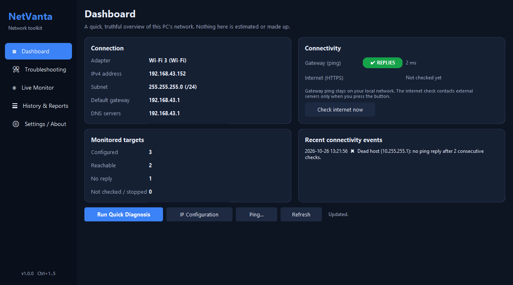
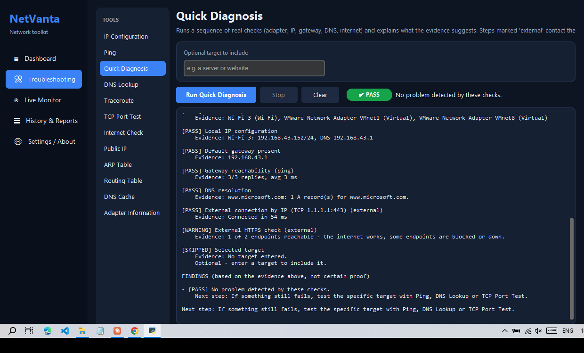
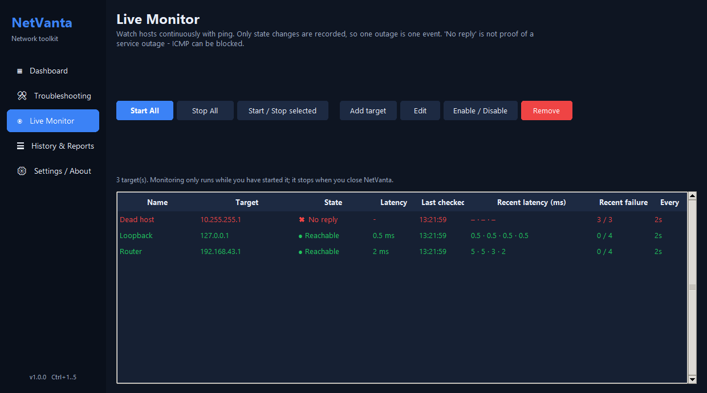

# NetVanta

A modern, friendly network troubleshooting and monitoring toolkit for **Windows 10/11**.
Check IP settings, ping, trace routes, query DNS, test ports, watch hosts live, and run a guided
diagnosis - all inside one app, without opening Command Prompt.



## Install (for users)

1. Download **`NetVanta-Setup-1.0.0.exe`** (built into `installer/Output/`, or from the repository's Releases page).
2. Double-click it and follow the wizard. No administrator rights and no Python are needed.
3. Start **NetVanta** from the Start menu or the desktop shortcut.

To remove it use *Settings > Apps > NetVanta > Uninstall*. Your history/settings live in `%APPDATA%\NetVanta`.

## Features

| Area | What it does |
|---|---|
| **Dashboard** | Current adapter, IP, subnet, gateway, DNS, gateway ping, internet check (on demand), monitor summary, recent events |
| **Quick Diagnosis** | Real checks (adapter, IP, gateway, gateway ping, DNS, external TCP, HTTPS, optional target) + evidence-based findings |
| **IP Configuration / Adapter Information** | Every adapter with addresses, gateway, DNS, MAC, speed, traffic. Detects Wi-Fi / Ethernet / VPN / Virtual |
| **Ping** | Live replies, loss % and min/avg/max, Stop button, clear error messages |
| **DNS Lookup** | A, AAAA, MX, NS, TXT, CNAME with an optional custom resolver; NXDOMAIN / no-record / timeout reported separately |
| **Traceroute** | Live hops, partial results on cancel/timeout |
| **TCP Port Test** | One port, a list or a range (max 20), distinct connected / refused / timeout / DNS outcomes |
| **Internet Check / Public IP** | Optional, clearly marked external requests |
| **ARP / Routing table / DNS cache** | Read-only viewers with filter, copy and export |
| **Live Monitor** | Many targets, per-target start/stop, state-change events only (no outage spam), saved between runs |
| **History & Reports** | SQLite history, time/tool/text filters, sort, CSV/JSON export, confirmed delete |
| **Settings** | Theme (dark/light/system), defaults, log level, export folder, privacy note |

Everything that changes your PC is deliberately absent: NetVanta is **read-only** (no flushing DNS, no route edits,
no adapter changes). Nothing is uploaded; there is no telemetry.

| | |
|---|---|
|  |  |

## Documentation

All developer and user documentation lives in the [`development/`](development) folder:

- [USER_GUIDE.md](development/USER_GUIDE.md) - how to use every tool
- [HOW_TO_USE.md](development/HOW_TO_USE.md) - run from source, test, build the exe and installer, publish
- [PROJECT_STRUCTURE.md](development/PROJECT_STRUCTURE.md) - folders, modules and data flow
- [TECHNOLOGY.md](development/TECHNOLOGY.md) - stack and design decisions
- [KNOWN_LIMITATIONS.md](development/KNOWN_LIMITATIONS.md) and [VERIFICATION.md](development/VERIFICATION.md)
- [NetPulse_Master_Development_Prompt.md](development/NetPulse_Master_Development_Prompt.md) - the original product specification

## Run from source (developers)

```powershell
python -m venv .venv
.\.venv\Scripts\python -m pip install -r requirements-dev.txt
.\.venv\Scripts\python app.py
```

Run the tests: `.\.venv\Scripts\python -m pytest -q`
Build the exe and installer: `powershell -ExecutionPolicy Bypass -File build.ps1`

## Limitations (short list)

Windows only. ICMP replies can be blocked by firewalls, so "no reply" is never treated as proof a host is down.
See [KNOWN_LIMITATIONS.md](development/KNOWN_LIMITATIONS.md).

## License

MIT - see [LICENSE](LICENSE). Author: Avishka Withanage.
